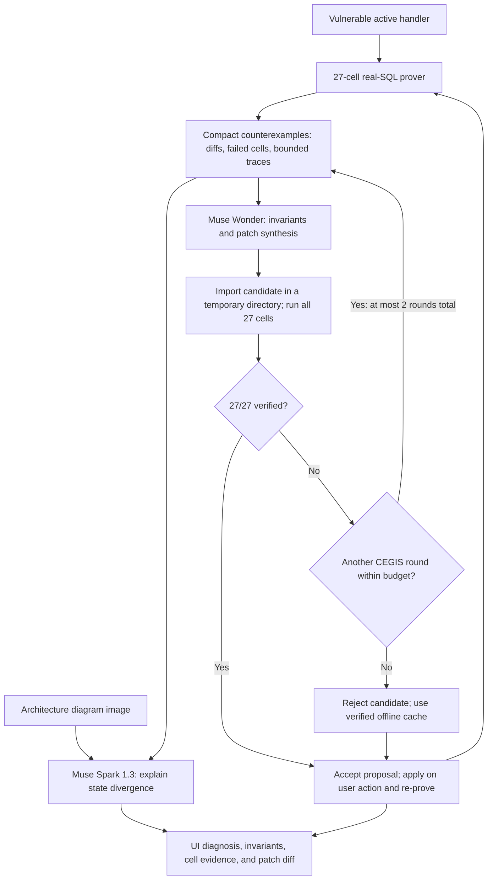

# The Brass Escapement (ChaosHook)

Bounded, executable webhook scenario verification with Meta model repair.

Built for the **Meta Global AI Developer Hackathon · Indie Developer Track**.

AI-written webhook handlers can pass happy-path tests yet corrupt state under event reordering, concurrent duplicate bursts, and mid-handler crashes.
ChaosHook demonstrates these failures deterministically using 27 real-SQL schedules and compares each result against a golden state.
During live analysis, Meta Muse Wonder synthesizes repair candidates, while Meta Muse Spark 1.3 explains the divergence using counterexamples and an architecture diagram image. Cached mode supplies a predefined repair and diagnosis. Independent scenario verification evaluates candidate behavior without model calls.

## The problem

Webhook consumers must handle at-least-once, unordered delivery: retries can repeat an event, and arrival order can differ from causal order.
The delivery and idempotency background is documented in sources already cited by this repository: [Creuto](https://creuto.com/webhook-retry-patterns-ordering-idempotency), [Keplaris](https://keplaris.com/blogs/webhook-idempotency-retries), and [Prismatic](https://prismatic.io/blog/how-do-i-make-webhook-processing-idempotent/).

ChaosHook exercises three failure classes:

- **Out-of-order causal inversion:** cancellation arrives before creation, or an older event overwrites newer state. Missing deletion tombstones and timestamp guards can resurrect a canceled subscription.
- **Concurrent duplicate TOCTOU race:** both workers read “event unseen” before either records it, so both grant invoice credits. A sequential duplicate check cannot prevent this race.
- **Mid-handler crash + retry amplification:** a handler commits credits or a welcome-email record, crashes before recording completion, then repeats the effect on retry.

## How it works



CEGIS means counterexample-guided inductive synthesis: a rejected candidate's remaining failures and import error become feedback for the next synthesis attempt.
Wonder receives high-level design requirements in its system prompt (single-transaction ON CONFLICT claim, tombstones, monotonic watermarks, no intermediate commits) alongside the schema, the active handler, an interface contract, and compact counterexamples. It receives no reference code.
There are at most two synthesis rounds, with a 240-second budget heuristic that can skip round 2.
Wonder synthesis and Spark diagnosis run concurrently during live analysis.

Each proof cell uses an isolated SQLite database cloned from the initial state with `sqlite3.Connection.backup()`.
SQLAlchemy synchronous statement hooks coordinate a real two-thread barrier and inject crash exceptions at side-effect boundaries.
The golden state S* is constructed by the frozen `LifecycleScenarioSpec` in `chaoshook_engine/scenario_spec.py`, independently of any handler implementation. Its declared outcomes are a canceled user plan and subscription, subscription period end `1702592000`, initial credit balance `0` plus exactly `100` invoice credits, exactly one ledger row totaling `100`, and exactly one `welcome_pro` outbox record for the seeded user.
The executable contract checks these outcomes, the ledger's invoice and user attribution, outbox attribution and template, and unexpected execution errors or missing barrier/crash evidence. Expected injected crashes are handled by the runner. Structured violations appear in each cell's `property_violations`; existing state diffs and `golden_state` remain available.
The verification gate neither imports nor executes `v2_patched.py` to calculate expected state. That file remains an example repair used for the cached demo and as an explicit candidate in regression tests and CLI verification.
The UI exposes terminal-state differences, SQL traces, and schedule diagrams for individual cells.

## Scenario requirements, 27 configured checks

ChaosHook performs bounded, executable scenario verification, not exhaustive mathematical formal verification. Order independence is a declared requirement of this particular four-event lifecycle, not a universal property of webhooks. The equations below express the intended properties; the fixed schedules exercise selected instances of concurrency and crash recovery.

Let H(S, e) apply event e to state S, E be the four canonical events, and fold apply a sequence of events.
Equality here means equality of the business-state fields compared by the prover, excluding surrogate IDs and delivery bookkeeping.

1. **Order commutativity:** `fold(H, S0, permutation(E)) = S*` for every permutation of E. Older arrivals must preserve newer business state.
2. **Duplicate idempotency:** `H(H(S, e), e) = H(S, e)`. Concurrent duplicate delivery must also have the business effect of one successful delivery.
3. **Crash-retry atomicity:** `retry(crash(H, S, e), e) = H(S, e)`. A failed attempt followed by retry must converge to one successful execution.

The fixed verification matrix is `4! + 1 + 2 = 24 + 1 + 2 = 27` cells:

| Cells | Schedule | What it checks |
| --- | --- | --- |
| 1–24 | All 24 permutations of the four lifecycle events | Cancellation survives causal inversion and stale arrivals |
| 25 | Two threads deliver the same invoice at a SQL barrier | A single winner claims the event and grants credits |
| 26 | Crash during invoice handling, then retry | Credits and the event claim recover atomically |
| 27 | Crash during checkout handling, then retry | The welcome-email outbox effect occurs once |

The verified handler combines claim-first `INSERT ... ON CONFLICT(event_id) DO NOTHING`, one transaction, deletion tombstone upserts, monotonic timestamp guards, and transactional outbox writes.

## Measured results

Actual local measurements from `python -m chaoshook_engine.cli verify --mode both` and a direct prover run of `v1_partial_idempotent.py`:

| Handler | Passed | Failed | Prover time |
| --- | ---: | ---: | ---: |
| Vulnerable baseline | 6/27 | 21 | 561.784 ms |
| Naive idempotency-only patch | 9/27 | 18 | 536.791 ms |
| Verified patch | 27/27 | 0 | 441.551 ms |

The CLI prints `Gate PASS` for the vulnerable baseline because reproducing its expected 6/27 score is the verification gate's success criterion.
The partial patch fixes the race and both crash-retry cells, but still fails 18 ordering permutations.
Timings depend on the machine and filesystem.

Previously recorded live synthesis runs: Muse Wonder produced patches that passed 27/27 in CEGIS round 1 with no reference solution (about 150 s per live run, both from the CLI and from the UI). These are historical observations, not results from cached mode or this documentation pass.

Live results vary, and a live Diagnose costs real credits.
An offline verified cache exists so the demo never depends on the network: enable **Instant mode (cached)** to avoid model requests.
Missing configuration, request failures, or unsuccessful synthesis also fall back to deterministic cached analysis and the predefined example repair. This fallback is not generated live. Candidate acceptance is determined separately by the independent business contract across the configured schedules, regardless of whether the repair was synthesized live or loaded from cache.
The UI labels **VERIFIED CACHE** versus **LIVE MODEL**, identifies the patch source separately, and reports whether Spark actually saw the diagram or used text-only input.
The table records earlier local verification timings without live model calls; the live synthesis observations are separate historical project results.

## Meta models

| Model ID | Implemented role |
| --- | --- |
| `muse-wonder-1.0` | Extracts four structured invariants and synthesizes a complete handler from schema, source, contract, and compact counterexamples; candidates are verified in isolation before acceptance |
| `muse-spark-1.3` | Explains three failure clusters and a remediation plan from the compact failure matrix; can also ingest the architecture diagram image and return diagram findings |

The client uses an OpenAI-compatible HTTP API with configurable model IDs and endpoint.
The UI rasterizes its built-in architecture diagram to PNG, or accepts a PNG/JPEG upload.
Spark retries an image request without structured-output formatting on a 4xx error, then can fall back to text-only diagnosis before using the offline cache.
Cached diagnosis is predefined baseline analysis; it does not perform image interpretation or fresh reasoning about arbitrary edits.

## Try it in 60 seconds: Instant mode

With the backend and UI running:

1. Click **Reset to Vulnerable Baseline**.
2. Click **Run 27-Cell Prover** and confirm **6/27**.
3. Inspect cells **14**, **25**, and **26** for ordering corruption, duplicate credits, and crash-retry amplification. Compare S* against actual state and inspect the SQL traces.
4. Enable **Instant mode (cached)**, then click **Diagnose & Synthesize Patch (Muse Wonder + Spark 1.3)**.
5. In **Muse Analysis**, click **View Atomic Patch** to inspect the unified diff.
6. Click **Test Naive Idempotency-Only Patch**. The prover rejects it at **9/27**, leaving the active handler unchanged.
7. Click **Apply Atomic Patch & Re-Prove (27/27)**. Confirm all **27/27** cells pass.

The Target Code panel also has **Edit Live Code** with a numbered textarea, inline syntax errors, and **Save Edit & Run 27-Cell Prover**.
**Load naive partial patch** only fills the draft; saving installs it and runs the matrix even when it fails.
A failing edited handler is labeled **CUSTOM EDIT (n/27)** in amber, and resetting the baseline exits edit mode.

## Quickstart

The validated Ubuntu Linux environment is **Ubuntu 24.04, Python 3.12.3,
Node 22.23.4, npm 10.9.9**. Python 3.11 is the code's minimum; other Python
versions have not been exercised here. Use Python 3.12 for reproduction. The
frontend declares Node `>=22.20 <23` and npm `>=10 <11`, matching the validated
major versions and the locked native dependency requirements. No Docker or
external database service is required.

On a fresh WSL Ubuntu 24.04 shell, install OS prerequisites:

```bash
sudo apt update
sudo apt install python3 python3-venv python3-pip git
```

Install Node 22.23.4 with npm 10 using your existing Node version manager (for
example, `nvm install 22.23.4` then `nvm use 22.23.4`). Ubuntu's default Node
package may not match the required version. Use Linux Node/npm inside WSL, and
keep the checkout under `~/projects`, rather than a Windows-mounted directory,
for SQLite locking and filesystem performance. Clone the repository, enter its
root, then run:

```bash
python3 -m venv .venv
source .venv/bin/activate
python -m pip install -r requirements.txt
python -m pip check
python -m chaoshook_engine.cli preflight
```

The preflight exits nonzero for missing/import-broken Python dependencies,
unsupported Node/npm, missing git, or unwritable temporary storage. It works
before third-party dependencies are installed. It reports only configuration
presence, never values, and performs no network requests. It probes both the
configured temporary directory and `/tmp`, used by candidate verification.
It does not prove API connectivity, port availability, or production DB semantics.

Python direct dependencies and Starlette's API/TestClient integration are pinned
to the locally validated versions in `requirements.txt`. Transitive Python
requirements still resolve at install time: this is not a complete hash-locked
Python environment. Run `pip check` after installation; package index access and
compatible wheels are required on first install. The frontend's committed v3
lockfile includes exact transitive versions and integrity hashes. Use `npm ci`,
which checks consistency and avoids re-resolving versions; do not regenerate the
lockfile as part of setup. The existing Vite React plugin remains in place.

### Offline demo setup

No `.env` or API credential is required for `verify`, `evaluate`, `qualify`, or
`demo`. For the dashboard's deterministic cached analysis, run
`export DEMO_FALLBACK_CACHE=true` before starting the backend, or copy
`.env.example` to `.env` and set that flag to `true`. Cached output uses the
prepared reference, not live generation. Installing dependencies initially
requires network access or previously downloaded packages; offline operation
refers to the installed demo.

### Optional live Muse setup

Copy `.env.example` to `.env` without overwriting an existing private file, then
supply your API key and provider-confirmed compatible base URL/model IDs. The
example URL is a configuration example, not a verified available endpoint. Set
`DEMO_FALLBACK_CACHE=false` to enable live analysis. Run
`python -m chaoshook_engine.cli preflight --live` to check presence only; this
does not contact the service or validate credentials. The example selects
`muse-wonder-1.0`, `muse-spark-1.3`, and a 180-second timeout. Request failures fall
back to cached analysis. Live diagnosis incurs provider costs. The client loads
`.env` without overriding process environment values. `.env` is gitignored;
never commit credentials or paste them into evidence exports.

Start the backend:

```bash
source .venv/bin/activate
uvicorn chaoshook_engine.server:app --host 127.0.0.1 --port 8000
```

In another terminal, start the UI:

```bash
cd ui
npm ci --no-audit --no-fund
npm run dev
```

Open [the dashboard](http://localhost:5173). Vite proxies `/api` to the backend on port 8000.

Deterministic verification and regression export:

```bash
python -m chaoshook_engine.cli verify --mode both
pytest -q tests/test_gate.py
python -m chaoshook_engine.cli export-pytest --out test_webhook_invariance.py
pytest -q test_webhook_invariance.py
```

The verification command must print vulnerable **6/27** and patched **27/27**,
with both gates passing: the vulnerable score is an expected demonstration result.
Neither command installs the repaired handler. Additional seeded evaluation and
mutation controls are separate from runtime acceptance:

```bash
python -m chaoshook_engine.cli evaluate --source target_app/handlers/v2_patched.py --seed 101 --seed 202 --seed 303
python -m chaoshook_engine.cli qualify --source target_app/handlers/v2_patched.py --seed 101 --seed 202 --manifest /tmp/qualification.json
python -m pytest -q tests/test_gate.py -k mutation
python -m pytest -q -s tests/test_gate.py -k mutation_summary
```

The last command prints the temporary mutation-summary JSON path. These are known
regression seeds, not unseen held-out evidence. See the qualification and demo
sections below for manifest semantics. To check the frontend build, run
`npm run build` from `ui/` after `npm ci`.

The exported suite imports the active handler and runs the prover once through a module-scoped fixture, producing 24 permutation tests, one barrier test, and two crash-retry tests.
It deliberately fails against the vulnerable baseline; all 27 tests pass when the active handler is verified.
`GET /api/export-pytest` returns the same source in the `filename` and `pytest_code` fields.

### Reproducible verification manifest (schema version 1)

The existing regression export optionally runs verification and writes a JSON
manifest alongside the unchanged pytest source. It uses `verify_candidate_patch`
for the legacy acceptance gate and `evaluate_candidate_patch` for explicitly
requested additional seeds. It makes no Muse requests and never installs source:

```bash
.venv/bin/python -m chaoshook_engine.cli export-pytest \
  --out /tmp/test_webhook_invariance.py \
  --manifest /tmp/verification.json \
  --source target_app/handlers/v2_patched.py
```

Omit `--source` to verify a frozen copy of `active_handler.py`. Append
`--seed 101 --seed 202` to execute 27 additional schedules per seed. Without
`--seed`, additional scenarios have `evaluated: false`, `status: not_evaluated`,
and `all_passed: null`. These are separate evaluation results and do not affect
`runtime_acceptance.accepted`, which retains the existing legacy 27/27 criterion.
Export labels additional inputs `evaluation`; it does not infer held-out status
or consume the separate `evaluate --history` workflow. Mutation controls are
marked `not_evaluated` and `regression_only_not_acceptance`; this command does not
run or import the pytest mutation summary.

Exit code is 0 when legacy acceptance and all requested additional evaluations
pass; otherwise it is 1, with both exports still written. Argument errors use
argparse's exit code 2. Plain `export-pytest --out ...` keeps its previous
read-only behavior and does not execute verification. `/api/export-pytest`, all
existing API fields, verification criteria, and the React UI are unchanged.
The generated pytest suite still tests the active handler **when pytest runs**;
the manifest describes the source snapshot chosen at export time. `--source`
does not install that source or embed it in the generated suite. Run the suite
from a checkout of this project (or with its packages on the Python path).

Candidate provenance defaults to `prepared`, including source matching the
example repair. To preserve a recorded origin, append
`--candidate-audit /tmp/candidate-audit.json`. Supply an existing individual
CEGIS candidate record or the existing `model_routing` object containing a
`selected_candidate`. Its source SHA-256, contract hash, and known provenance
(`prepared`, `cached_fallback`, or `live_model_response`) must match; stale or
unknown records are rejected before execution. Only the provenance enum is
exported. `provenance_basis` identifies supplied audit records; these local
records are caller-supplied evidence, not authenticated proof of model authorship.
The tool never infers live generation from filenames or matching reference code.

The manifest includes:

- The contract identifier, existing contract SHA-256, and the independent
  oracle source file's SHA-256. Contract/scenario hashes use UTF-8
  `json.dumps(asdict(scenario), sort_keys=True)` (default JSON separators).
- SHA-256 of the exact frozen UTF-8 candidate bytes, preserving CRLF newlines.
- Scenario seeds, fixture identifiers, scenario hashes, and fixture hashes over
  `{"initial_users": scenario.initial_users(), "events": get_canonical_events(scenario)}`
  using the same JSON hashing convention. Authentication signatures are excluded.
- Per-scenario executed schedule IDs and counts, passed/failed check IDs,
  unevaluated check IDs, business-property violation identifiers, and execution
  and synchronization error codes/counts. Schedule IDs retain the existing
  mapping: 1–24 lexicographic permutations of e1–e4, 25 the duplicate SQL barrier,
  26 the invoice crash/retry, and 27 the checkout crash/retry.
- Separate legacy acceptance, additional evaluation status, and mutation scope.

Only cells in returned prover reports count as executed. Summary totals and
configured schedule lists cannot manufacture passes. Import failures record zero
executed checks. Fatal verifier errors record a generic error code and no check
results for the interrupted scenario because the runner returns reports only on
completion; earlier completed additional scenarios remain recorded. This is a
completed-result export, not an interruption journal or resumable run log.

Serialization sorts keys, schedule IDs, properties, errors, and seeds. It includes
no timestamps or durations, so identical inputs and executed outcomes produce
byte-identical files regardless of temporary paths, thread ordering, or signing
time. This does not freeze the execution environment or guarantee arbitrary
candidate code is deterministic. Keep the source and project revision to replay;
the manifest does not bundle them or dependencies. The existing finite-scenario,
SQLite, trusted-local-code execution limitations still apply.

Redaction uses an allowlist, not secret-pattern matching: raw source, prompts,
SQL, candidate/model messages, environment values, headers, exception text, and
expected/actual violation values are never copied. Business violations retain
only known property names and check IDs; account-specific field paths normalize
to `primary`/`bystander`, and unknown names become `unrecognized_business_property`.
Errors retain counts and fixed codes (`handler_execution_error`,
`barrier_not_reached`, `barrier_broken`, `crash_not_injected`,
`candidate_import_error`, `verification_error`). Consult the local report/UI for
detailed values and traces; the portable manifest deliberately omits them.

### Optional post-repair qualification

Qualify a frozen candidate separately from repair acceptance:

```bash
.venv/bin/python -m chaoshook_engine.cli qualify \
  --source target_app/handlers/v2_patched.py --seed 101 --seed 202 \
  --manifest /tmp/qualification.json
```

`qualify_candidate_patch(source, seeds, contract=SCENARIO_SPEC, candidate_audit=None)`
rechecks the original 27-cell gate before executing additional seeded scenarios.
Seeds must be explicit, nonempty, distinct integers. The optional contract argument
must equal the existing frozen contract; it cannot redefine the expected outcomes.
The same exact UTF-8 source hash is checked for the base result and every seeded
evaluation. Execution proceeds in sorted seed order, retaining earlier completed
results if another seed errors. `--candidate-audit` accepts the same existing
hash-bound provenance records described above. This command never installs code,
calls Muse, or changes synthesis, cache fallback, or acceptance behavior.

The returned result is the existing schema-v1 manifest with one optional additive
`qualification` object. All previous fields retain their meanings. Candidate and
contract hashes remain at `candidate.source_sha256` and `contract.sha256`; exact
seeds, coverage, failures, and redacted violations remain in `additional_scenarios`.
The qualification object uses the label **additional seeded qualification**.
It makes no claim that regression seeds 101/202/303 are unseen or independently
reserved. Individual run labels remain `evaluation` for compatibility.

- `base_verification_status`: `passed`, `failed`, or `incomplete_or_errored`.
- `status`: `passed` only after base verification and every requested seed
  complete all 27 schedules and pass; `failed` when all requested scenarios
  complete but any check fails; `incomplete_or_errored` when seeded evidence is
  missing, partial, invalid, or an evaluator raises; `not_evaluated` when the base
  gate fails or cannot complete, with `not_evaluated_reason` identifying why.
- `qualified`: true only for `status: passed`. `completed_seeds` includes fully
  executed failing scenarios too. `errors` contains only fixed error codes.

Completed handler/synchronization check failures produce `failed`; fatal
evaluator exceptions with no returned report produce `incomplete_or_errored`.
An incomplete run takes precedence over a completed failure in the overall
status; individual failures remain visible. A base pass is preserved even when
qualification fails. CLI exit code is 0 only when qualified, 1 otherwise; invalid
arguments use 2. JSON is printed to stdout and, with `--manifest`, saved identically
even when qualification fails. Without a `qualification` object, an older/export
manifest makes no qualification claim. Mutation controls remain separate.
The existing finite-scenario, redaction, interrupted-report, and replay limitations
apply; passing these known seeds is bounded evidence, not universal correctness.

### Single-command offline evidence demo

```bash
.venv/bin/python -m chaoshook_engine.cli demo --out /tmp/chaoshook-demo
```

This reuses qualification and schema-v1 exports: the vulnerable baseline must
reproduce 6/27 base passes, and the **prepared reference repair** must pass 27/27
plus additional seeded qualification. Default seeds are 101, 202, 303; override
with repeated `--seed` arguments. The baseline's failed base gate skips its
additional qualification. No live models, installation, or active-handler edits
occur. Acceptance rules and all existing commands remain unchanged.

Outputs are `vulnerable.json`, `repaired.json` (including every completed seeded
scenario), `demo.json` (outcomes, hashes, seeds, counts, and exact replay argument
lists), and `summary.md`. Replay commands assume the output directory as the
working directory and the project packages on `PYTHONPATH`; the baseline replay
returns 1 because its failures are expected. The demo returns 0 only when all
expected results are reproduced; execution errors or unexpected outcomes return
nonzero. Returned errors are redacted; unavailable reports count as zero executed
checks. Files with these names are replaced on reruns. No timestamps, durations,
or output-directory paths enter the evidence, so identical source, project path,
contract, seeds, and outcomes produce identical files. Keep the source checkout
to replay; these known finite scenarios are not unseen held-out evidence or a
general correctness proof.

Optional live checks, which make billable network requests:

```bash
python -m chaoshook_engine.cli ping-muse
python -m chaoshook_engine.cli live-patch-check
```

`ping-muse` probes the configured models even when cache mode is enabled.
For `live-patch-check`, disable cache mode; it synthesizes and verifies a candidate against the configured checks in a temporary directory without installing it, and returns failure if live synthesis falls back to cache.

## Repository map

| Path | Purpose |
| --- | --- |
| `target_app/` | Independent SQLAlchemy models, payload schemas, HMAC verification, and recorded outbox effects |
| `target_app/handlers/` | Vulnerable, partial, reference, and hot-swappable active handlers |
| `chaoshook_engine/runner.py` | Real-SQL 27-cell matrix and pytest export template |
| `chaoshook_engine/scenario_spec.py` | Frozen independent business outcomes and executable acceptance predicates |
| `chaoshook_engine/snapshot.py`, `interceptors.py`, `fixtures.py` | SQLite clones, business-state comparisons, scheduling hooks, and canonical signed events |
| `chaoshook_engine/muse_client.py`, `patcher.py` | Model routing, compact counterexamples, CEGIS, isolated verification, installation, and rollback |
| `chaoshook_engine/server.py`, `cli.py` | Local JSON API and terminal commands |
| `ui/src/` | React dashboard, proof matrix, state/trace inspector, diagram input, patch diff, and live editor |
| `tests/test_gate.py` | Behavioral gates, API checks, model-client checks, and exported-suite tests against temporary repo copies |
| `docs/` | Product specification, architecture notes, edge cases, and task history |

## Honest limitations

- **One scenario:** the fixture is a four-event Stripe-style lifecycle: checkout, subscription creation, invoice payment, and subscription deletion. This is not arbitrary repository analysis or comprehensive provider coverage.
- **SQLite stands in for production:** WAL mode and real SQL expose these defects locally, but production database locking and isolation can differ.
- **A finite schedule set:** 27 fixed schedules cover all permutations of four events and three targeted fault schedules, not every interleaving, payload, or crash position. Passing is evidence within this model, not a universal correctness proof.
- **Recorded effects:** welcome emails are database outbox records; the demo does not deliver actual emails or prove external-service exactly-once behavior.
- **Local code execution:** the editable pane executes submitted Python code during import and proof. It is a trusted localhost-only development tool, not a sandbox; keep the backend bound to `127.0.0.1` and do not expose it publicly.
- **Patch acceptance:** synthesized/candidate patches are accepted only when the prover verifies them. The live editor intentionally permits failing handlers so users can introduce bugs and inspect counterexamples; saving an edit does not certify it.

## License

MIT License. Copyright (c) 2026 Kyoka Suigetsu. See [LICENSE](LICENSE).

## Opt-in contract-driven synthesis experiment

The guided dashboard/CEGIS path remains the default demonstration path, with
its original prompts, request formatting, credential handling and verified cache.
The separate `synthesis-experiment` command measures whether Wonder can produce
a repair from business obligations and execution evidence without the guided
repair recipe. It never installs a candidate and never substitutes cached code.
No live trials were performed during implementation; mocked tests are not a
measured live success rate.

For a controlled **three-trial** experiment, configure the existing private
`MUSE_API_KEY`, `MUSE_BASE_URL`, and `MUSE_WONDER_MODEL` settings, then run:

```bash
DEMO_FALLBACK_CACHE=false .venv/bin/python -m chaoshook_engine.cli synthesis-experiment \
  --synthesis-mode contract-driven --trials 3 --max-attempts 2 \
  --out /tmp/chaoshook-contract-three
```

This explicitly authorizes up to **six billable model requests**: three fresh
trials with at most two bounded CEGIS attempts each. A fully qualified candidate
ends its trial early. Transport, configuration or malformed-response errors end
the current trial, retain its output, and advance to the next reserved trial.
There are no hidden transport retries or replacements for failed trials. Forced
cache configuration blocks experiments and is recorded as unsuccessful rather
than used as live evidence. The output directory must be fresh; an existing
experiment is never overwritten. Temperature remains 0, so independent sessions
can produce identical output; these are not guaranteed statistically independent
samples. There is no runtime attempt budget beyond the explicit attempt count
and existing per-request timeout.

Optional guided-prompt comparison, with an equal predeclared trial budget:

```bash
DEMO_FALLBACK_CACHE=false .venv/bin/python -m chaoshook_engine.cli synthesis-experiment \
  --synthesis-mode guided --trials 3 --max-attempts 2 \
  --out /tmp/chaoshook-guided-three

.venv/bin/python -m chaoshook_engine.cli compare-synthesis \
  --record /tmp/chaoshook-contract-three/trials.json \
  --record /tmp/chaoshook-guided-three/trials.json \
  --out /tmp/chaoshook-synthesis-comparison
```

The guided **experiment** uses the existing guided system prompt and repeated
interface instructions; its first request uses the same guided payload projection.
Both experimental arms use the same strict verification stop condition and
predeclared attempt cap, and both disable fallback. Subsequent guided experimental
attempts also receive strict execution feedback. This comparison evaluates prompt
conditions under this harness, not the default guided workflow's cache or its
legacy-only stopping rule. The default guided workflow itself is unchanged.
Comparison makes no model calls. With records from only one mode, the other is
reported as not evaluated; external historical success claims are not added to
the denominator. Mocked records are excluded from live success counts.

Each experiment writes:

- `trials.json`: all preallocated trial slots, completion status, mode, configured
  and actual response model identifiers (null if not supplied), every request and
  sanitized response, attempt number, completion reason, source/hash, fallback
  flag, independent base and strict outcomes, full verification manifests and
  bounded sanitized feedback. Candidate hashes bind the exact evaluated source;
  if redaction changes retained source, `candidate_source_redacted` records that.
- `comparison.json` and `comparison.md`: machine-readable counts and a readable
  comparison based exclusively on the retained trials. All requested slots count,
  including unsuccessful and interrupted ones. Partial journals retain pending
  or running states; a new command requires a new directory. Keep all original
  experiment records when making a combined comparison.

Contract-driven prompts are built separately from `WONDER_PROMPT`, its repeated
`handler_contract`, Spark diagnoses, cache invariant descriptions and guided retry
instructions. They include the vulnerable module, public entry point, schema and
payload interface, welcome helper interface, independently specified outcomes,
actual execution failures, and import/runtime constraints. Schema facts such as
the `last_event_ts` columns remain visible, but no advice about how to use them is
supplied. The contract describes which delivered lifecycle fact wins under its
synthetic timestamps; it does not prescribe a storage or merge algorithm. No
reference source or successful candidate is provided as an example. A retry sees
only its own preceding candidate and real verifier feedback, never another
trial's output. Strict feedback is capped at 12 failing checkpoints per history;
complete results remain in the recorded evidence.

Every generated nonempty candidate source is imported and evaluated through the
existing independent qualifier against both the unchanged legacy **27-cell**
gate and `novacloud-causal-counterfactual-v1` (**62 schedules / 526 checks** when
fully executed). Import failures are retained with zero executed semantic checks.
Legacy acceptance and strict qualification are recorded separately. A 27/27
candidate that fails strict semantics remains rejected for full qualification,
and its actual defect evidence is retained. No candidate is automatically
installed. In this experiment, retained API responses establish live-response
provenance; fallback never establishes live success. An absent response model ID
remains unknown rather than being replaced with the requested ID.

Implementation regression tests use mocked responses to cover an unsuccessful
partial repair followed by a qualified repair, a legacy-passing hardcoded
cancellation candidate rejected by strict semantics, independent three-trial
retention, malformed responses, import errors, credential redaction, offline
blocking, prompt separation and comparison accounting. They do not establish
Muse's live experimental repair capability. Neither verification contract nor
the prepared reference is changed for this experiment. Bounded public-contract
success is not general correctness or evidence of held-out generalization.
