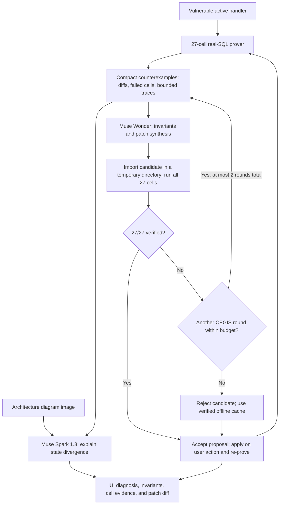

# The Brass Escapement (ChaosHook)

Bounded, executable webhook scenario verification with Meta model repair.

Built for the **Meta Global AI Developer Hackathon · Indie Developer Track**.

AI-written webhook handlers can pass happy-path tests yet corrupt state under event reordering, concurrent duplicate bursts, and mid-handler crashes.
ChaosHook demonstrates these failures deterministically using 27 real-SQL schedules and compares each result against a golden state.
During live analysis, Meta Muse Wonder synthesizes repair candidates, while Meta Muse Spark 1.3 explains the divergence using counterexamples and an architecture diagram image. Cached mode supplies a predefined repair and diagnosis. Independent scenario verification evaluates candidate behavior without model calls.

## The problem

Webhook consumers must handle at-least-once, unordered delivery: retries can repeat an event, and arrival order can differ from causal order.
The delivery and idempotency background is documented in sources already cited by this repository: [Creuto](https://creuto.com/webhook-retry-patterns-ordering-idempotency), [Keplaris](https://keplaris.com/blogs/webhook-idempotency-retries), and [Prismatic](https://prismatic.io/blog/how-do-i-make-webhook-processing-idempotent/).

ChaosHook exercises three failure classes:

- **Out-of-order causal inversion:** cancellation arrives before creation, or an older event overwrites newer state. Missing deletion tombstones and timestamp guards can resurrect a canceled subscription.
- **Concurrent duplicate TOCTOU race:** both workers read “event unseen” before either records it, so both grant invoice credits. A sequential duplicate check cannot prevent this race.
- **Mid-handler crash + retry amplification:** a handler commits credits or a welcome-email record, crashes before recording completion, then repeats the effect on retry.

## How it works



CEGIS means counterexample-guided inductive synthesis: a rejected candidate's remaining failures and import error become feedback for the next synthesis attempt.
Wonder receives high-level design requirements in its system prompt (single-transaction ON CONFLICT claim, tombstones, monotonic watermarks, no intermediate commits) alongside the schema, the active handler, an interface contract, and compact counterexamples. It receives no reference code.
There are at most two synthesis rounds, with a 240-second budget heuristic that can skip round 2.
Wonder synthesis and Spark diagnosis run concurrently during live analysis.

Each proof cell uses an isolated SQLite database cloned from the initial state with `sqlite3.Connection.backup()`.
SQLAlchemy synchronous statement hooks coordinate a real two-thread barrier and inject crash exceptions at side-effect boundaries.
The golden state S* is constructed by the frozen `LifecycleScenarioSpec` in `chaoshook_engine/scenario_spec.py`, independently of any handler implementation. Its declared outcomes are a canceled user plan and subscription, subscription period end `1702592000`, initial credit balance `0` plus exactly `100` invoice credits, exactly one ledger row totaling `100`, and exactly one `welcome_pro` outbox record for the seeded user.
The executable contract checks these outcomes, the ledger's invoice and user attribution, outbox attribution and template, and unexpected execution errors or missing barrier/crash evidence. Expected injected crashes are handled by the runner. Structured violations appear in each cell's `property_violations`; existing state diffs and `golden_state` remain available.
The verification gate neither imports nor executes `v2_patched.py` to calculate expected state. That file remains an example repair used for the cached demo and as an explicit candidate in regression tests and CLI verification.
The UI exposes terminal-state differences, SQL traces, and schedule diagrams for individual cells.

## Scenario requirements, 27 configured checks

ChaosHook performs bounded, executable scenario verification, not exhaustive mathematical formal verification. Order independence is a declared requirement of this particular four-event lifecycle, not a universal property of webhooks. The equations below express the intended properties; the fixed schedules exercise selected instances of concurrency and crash recovery.

Let H(S, e) apply event e to state S, E be the four canonical events, and fold apply a sequence of events.
Equality here means equality of the business-state fields compared by the prover, excluding surrogate IDs and delivery bookkeeping.

1. **Order commutativity:** `fold(H, S0, permutation(E)) = S*` for every permutation of E. Older arrivals must preserve newer business state.
2. **Duplicate idempotency:** `H(H(S, e), e) = H(S, e)`. Concurrent duplicate delivery must also have the business effect of one successful delivery.
3. **Crash-retry atomicity:** `retry(crash(H, S, e), e) = H(S, e)`. A failed attempt followed by retry must converge to one successful execution.

The fixed verification matrix is `4! + 1 + 2 = 24 + 1 + 2 = 27` cells:

| Cells | Schedule | What it checks |
| --- | --- | --- |
| 1–24 | All 24 permutations of the four lifecycle events | Cancellation survives causal inversion and stale arrivals |
| 25 | Two threads deliver the same invoice at a SQL barrier | A single winner claims the event and grants credits |
| 26 | Crash during invoice handling, then retry | Credits and the event claim recover atomically |
| 27 | Crash during checkout handling, then retry | The welcome-email outbox effect occurs once |

The verified handler combines claim-first `INSERT ... ON CONFLICT(event_id) DO NOTHING`, one transaction, deletion tombstone upserts, monotonic timestamp guards, and transactional outbox writes.

## Measured results

Actual local measurements from `python -m chaoshook_engine.cli verify --mode both` and a direct prover run of `v1_partial_idempotent.py`:

| Handler | Passed | Failed | Prover time |
| --- | ---: | ---: | ---: |
| Vulnerable baseline | 6/27 | 21 | 561.784 ms |
| Naive idempotency-only patch | 9/27 | 18 | 536.791 ms |
| Verified patch | 27/27 | 0 | 441.551 ms |

The CLI prints `Gate PASS` for the vulnerable baseline because reproducing its expected 6/27 score is the verification gate's success criterion.
The partial patch fixes the race and both crash-retry cells, but still fails 18 ordering permutations.
Timings depend on the machine and filesystem.

Previously recorded live synthesis runs: Muse Wonder produced patches that passed 27/27 in CEGIS round 1 with no reference solution (about 150 s per live run, both from the CLI and from the UI). These are historical observations, not results from cached mode or this documentation pass.

Live results vary, and a live Diagnose costs real credits.
An offline verified cache exists so the demo never depends on the network: enable **Instant mode (cached)** to avoid model requests.
Missing configuration, request failures, or unsuccessful synthesis also fall back to deterministic cached analysis and the predefined example repair. This fallback is not generated live. Candidate acceptance is determined separately by the independent business contract across the configured schedules, regardless of whether the repair was synthesized live or loaded from cache.
The UI labels **VERIFIED CACHE** versus **LIVE MODEL**, identifies the patch source separately, and reports whether Spark actually saw the diagram or used text-only input.
The table records earlier local verification timings without live model calls; the live synthesis observations are separate historical project results.

## Meta models

| Model ID | Implemented role |
| --- | --- |
| `muse-wonder-1.0` | Extracts four structured invariants and synthesizes a complete handler from schema, source, contract, and compact counterexamples; candidates are verified in isolation before acceptance |
| `muse-spark-1.3` | Explains three failure clusters and a remediation plan from the compact failure matrix; can also ingest the architecture diagram image and return diagram findings |

The client uses an OpenAI-compatible HTTP API with configurable model IDs and endpoint.
The UI rasterizes its built-in architecture diagram to PNG, or accepts a PNG/JPEG upload.
Spark retries an image request without structured-output formatting on a 4xx error, then can fall back to text-only diagnosis before using the offline cache.
Cached diagnosis is predefined baseline analysis; it does not perform image interpretation or fresh reasoning about arbitrary edits.

## Try it in 60 seconds: Instant mode

With the backend and UI running:

1. Click **Reset to Vulnerable Baseline**.
2. Click **Run 27-Cell Prover** and confirm **6/27**.
3. Inspect cells **14**, **25**, and **26** for ordering corruption, duplicate credits, and crash-retry amplification. Compare S* against actual state and inspect the SQL traces.
4. Enable **Instant mode (cached)**, then click **Diagnose & Synthesize Patch (Muse Wonder + Spark 1.3)**.
5. In **Muse Analysis**, click **View Atomic Patch** to inspect the unified diff.
6. Click **Test Naive Idempotency-Only Patch**. The prover rejects it at **9/27**, leaving the active handler unchanged.
7. Click **Apply Atomic Patch & Re-Prove (27/27)**. Confirm all **27/27** cells pass.

The Target Code panel also has **Edit Live Code** with a numbered textarea, inline syntax errors, and **Save Edit & Run 27-Cell Prover**.
**Load naive partial patch** only fills the draft; saving installs it and runs the matrix even when it fails.
A failing edited handler is labeled **CUSTOM EDIT (n/27)** in amber, and resetting the baseline exits edit mode.

## Quickstart

Requires Python 3.11+ and Node.js/npm compatible with Vite 6.
Everything runs locally with Python, SQLite, and Vite; Docker and external database services are unnecessary.

From the repository root:

```bash
python3 -m venv .venv
source .venv/bin/activate
pip install -r requirements.txt
cp .env.example .env
```

For a network-independent demo, set `DEMO_FALLBACK_CACHE=true` in your local `.env`; no model credential is required for Instant mode or deterministic scenario verification.
For live analysis, configure `MUSE_API_KEY` privately as described in `.env.example`, set `MUSE_BASE_URL` to your compatible service endpoint, and set `DEMO_FALLBACK_CACHE=false`.
The example selects `muse-wonder-1.0`, `muse-spark-1.3`, and a 180-second request timeout.
The client loads local `.env` settings without overriding existing process environment variables. Keep credentials out of commits and shared output.

Start the backend:

```bash
source .venv/bin/activate
uvicorn chaoshook_engine.server:app --host 127.0.0.1 --port 8000
```

In another terminal, start the UI:

```bash
cd ui
npm install
npm run dev
```

Open [the dashboard](http://localhost:5173). Vite proxies `/api` to the backend on port 8000.

Deterministic verification and regression export:

```bash
python -m chaoshook_engine.cli verify --mode both
pytest -q tests/test_gate.py
python -m chaoshook_engine.cli export-pytest --out test_webhook_invariance.py
pytest -q test_webhook_invariance.py
```

The exported suite imports the active handler and runs the prover once through a module-scoped fixture, producing 24 permutation tests, one barrier test, and two crash-retry tests.
It deliberately fails against the vulnerable baseline; all 27 tests pass when the active handler is verified.
`GET /api/export-pytest` returns the same source in the `filename` and `pytest_code` fields.

Optional live checks, which make billable network requests:

```bash
python -m chaoshook_engine.cli ping-muse
python -m chaoshook_engine.cli live-patch-check
```

`ping-muse` probes the configured models even when cache mode is enabled.
For `live-patch-check`, disable cache mode; it synthesizes and verifies a candidate against the configured checks in a temporary directory without installing it, and returns failure if live synthesis falls back to cache.

## Repository map

| Path | Purpose |
| --- | --- |
| `target_app/` | Independent SQLAlchemy models, payload schemas, HMAC verification, and recorded outbox effects |
| `target_app/handlers/` | Vulnerable, partial, reference, and hot-swappable active handlers |
| `chaoshook_engine/runner.py` | Real-SQL 27-cell matrix and pytest export template |
| `chaoshook_engine/scenario_spec.py` | Frozen independent business outcomes and executable acceptance predicates |
| `chaoshook_engine/snapshot.py`, `interceptors.py`, `fixtures.py` | SQLite clones, business-state comparisons, scheduling hooks, and canonical signed events |
| `chaoshook_engine/muse_client.py`, `patcher.py` | Model routing, compact counterexamples, CEGIS, isolated verification, installation, and rollback |
| `chaoshook_engine/server.py`, `cli.py` | Local JSON API and terminal commands |
| `ui/src/` | React dashboard, proof matrix, state/trace inspector, diagram input, patch diff, and live editor |
| `tests/test_gate.py` | Behavioral gates, API checks, model-client checks, and exported-suite tests against temporary repo copies |
| `docs/` | Product specification, architecture notes, edge cases, and task history |

## Honest limitations

- **One scenario:** the fixture is a four-event Stripe-style lifecycle: checkout, subscription creation, invoice payment, and subscription deletion. This is not arbitrary repository analysis or comprehensive provider coverage.
- **SQLite stands in for production:** WAL mode and real SQL expose these defects locally, but production database locking and isolation can differ.
- **A finite schedule set:** 27 fixed schedules cover all permutations of four events and three targeted fault schedules, not every interleaving, payload, or crash position. Passing is evidence within this model, not a universal correctness proof.
- **Recorded effects:** welcome emails are database outbox records; the demo does not deliver actual emails or prove external-service exactly-once behavior.
- **Local code execution:** the editable pane executes submitted Python code during import and proof. It is a trusted localhost-only development tool, not a sandbox; keep the backend bound to `127.0.0.1` and do not expose it publicly.
- **Patch acceptance:** synthesized/candidate patches are accepted only when the prover verifies them. The live editor intentionally permits failing handlers so users can introduce bugs and inspect counterexamples; saving an edit does not certify it.

## License

MIT License. Copyright (c) 2026 Kyoka Suigetsu. See [LICENSE](LICENSE).
